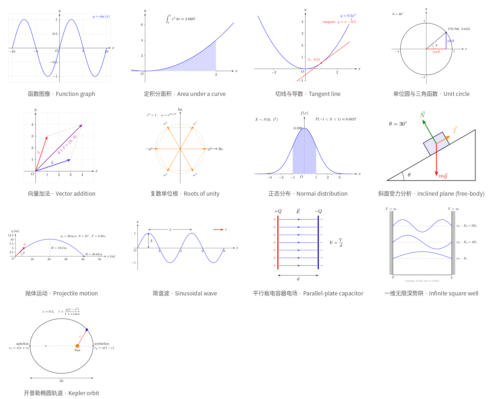

# ScienTikZ

**学术级 TikZ 图形，调参数即得，每张都经过真实编译。**
**Precise, compile-checked TikZ diagrams for maths & physics — set the parameters, get publication-ready code.**



## 它做什么 / What it does

1. 选一个图形，或直接搜索：`斜面 30度`、`y = x^3 - 3x`、`单位根 n=8`
2. 调参数（角度、函数、区间、偏心率……）
3. 右侧即时显示 **pdflatex 真实编译** 的预览
4. 复制 TikZ 代码，或下载 `.tex` / PDF / PNG / SVG，直接放进 Overleaf、论文、讲义

Pick a diagram (or search in Chinese/English, or type a formula), adjust its parameters, and get a live preview compiled by real pdflatex, plus copy-ready TikZ and `.tex` / PDF / PNG / SVG downloads.

## 为什么"精准" / Why it is precise

- **公式安全解析**：输入的公式先解析成语法树、按白名单检查，再生成 pgfmath，原始文本永远不会进入 LaTeX（防注入）。
- **pgfmath 与 Python 结果一致**：自动测试逐点比对 18 个公式（含 `x^2` 在负数处、`2^3^2` 结合律等 pgf 常见陷阱）。
- **自动处理奇点**：`1/x`、`tan(x)`、`ln(x)` 会在无定义处自动断开，不会画出错误的竖线，也不会触发 pgf 的 `Dimension too large`。
- **物理正确**：斜面图的支持力、摩擦力按平衡条件取长度（N = mg cosθ，f = mg sinθ），摩擦力方向沿斜面向上；积分值（Simpson）和正态概率（erf）都是数值计算出来的。
- **107 项自动测试**：每个图形在默认值、每个参数的上下限下都要编译通过。

## 图形库 v1.0（13 个）/ Diagram library

| 数学 Math | 物理 Physics |
|---|---|
| 函数图像（免费）· 定积分面积 · 切线与导数 · 单位圆（免费）· 向量加法（免费）· 复数单位根 · 正态分布 | 斜面受力分析（免费）· 抛体运动 · 简谐波 · 平行板电容器 · 一维无限深势阱 · 开普勒椭圆轨道 |

## 免费版与 Pro / Free vs Pro

| | 免费 Free | Pro |
|---|---|---|
| 全部 13 个图形的预览 | ✅ | ✅ |
| PNG 下载 | ✅ | ✅ |
| TikZ 源码 + .tex / PDF / SVG | 4 个免费图形 | ✅ 全部 |

Pro 通过**授权码**解锁，不需要注册登录，国内外用户都能用。
生成授权码：`python tools/make_keys.py 20`，把打印出的 `LICENSE_HASHES` 放进 Secrets。服务器上只存哈希，不存授权码本身。

## 本地运行 / Run locally

需要 Python ≥ 3.10、TeX Live（pdflatex + TikZ + standalone）和 poppler（`pdftocairo`）。

```bash
pip install -r requirements.txt
cp .streamlit/secrets.toml.example .streamlit/secrets.toml   # 可选：填入授权码哈希
streamlit run app.py
```

测试 / Tests: `pip install pytest && pytest -q`

## 部署 / Deploy

- **Streamlit Community Cloud（免费）**：连接本仓库，入口文件填 `app.py`；`packages.txt` 会自动安装 TeX；在 *Settings → Secrets* 粘贴 `LICENSE_HASHES` 和 `BUY_URL`。
- **任意服务器 / Docker**（适合放在国内可访问的服务器上）：
  ```bash
  docker build -t scientikz . && docker run -p 8501:8501 -e LICENSE_HASHES="hash1,hash2" scientikz
  ```

## 新增一个图形 / Add a diagram

在 `diagrams.py` 里写一个 `参数 → TikZ` 的函数，并用 `@diagram(...)` 注册。测试会自动编译它的默认值和所有参数边界，无需额外写测试。

```python
@diagram("my_id", "中文名", "English name", GROUPS[1], "搜索 关键词 keywords",
         [P("theta", "角度 θ (°)", 30.0, "float", 0, 90, 1.0)])
def build_my(v):
    return picture([f"\\draw[->] (0,0) -- ({num(v['theta'])}:2);"])
```

## 代码结构 / Layout

```
app.py          Streamlit 界面、搜索、授权码
diagrams.py     图形库（每个图形 = 参数 → TikZ）+ 搜索
engine.py       安全公式解析、pgfmath 生成、坐标轴/刻度/分段
render.py       pdflatex → PDF / PNG / SVG（带缓存、超时、禁用 shell-escape）
tools/          授权码生成
tests/          编译测试、pgf 数值一致性、注入防护、搜索
```

## Roadmap

- v1.1：更多物理图（电路、透镜成像、磁场、弹簧振子），中文标签（XeLaTeX）
- v1.2：在线支付（Polar / Stripe，支持支付宝），自动发放授权码
- v2：自然语言描述 → 图形（LLM 选模板、填参数，仍经过同一套编译校验）

## License

MIT
